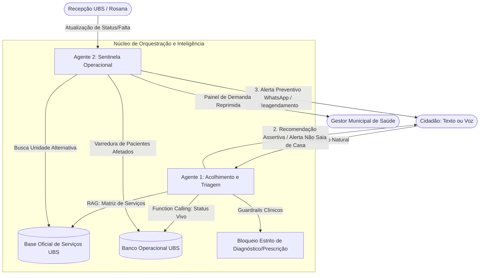

# 💙 Zelo — Dignidade e Previsibilidade no Acesso às UBS via Agentes de IA
> **AKCIT Camp Multicêntrico 2026 — Etapa Regional Nordeste (Recife/PE)**  
> **Squad 13:** Joshua, Deyvson, Luiz e Cauã  
> **Tema:** B2G / GovTech / HealthTech — Eliminação de filas da madrugada e viagens perdidas na Atenção Básica do SUS.

---

## 📌 Documentação e Artefatos do Pitch
- 📊 **Pitch Deck:** [`Pitch_Zelo_AKCIT.pdf`](./Pitch_Zelo_AKCIT.pdf)
- 📋 **Business Model Canvas:** [`BMC_Zelo.pdf`](./BMC_Zelo.pdf)

---

## 1. O Problema Real (Evidência e Validação)
Milhares de cidadãos enfrentam dois gargalos invisíveis na Atenção Básica do SUS:
1. **Filas de madrugada sem garantia de ficha:** Pacientes idosos (como nossa persona Dona Maria, 68 anos) e trabalhadores chegam às UBSs entre 04h00 e 06h00 sem saber se haverá fichas ou médico disponível.
2. **Desinformação operacional em tempo real:** Ferramentas genéricas informam apenas distância e horário comercial padrão, ignorando **catálogos reais de serviços** (ex.: postos que não aplicam vacinas) e **interrupções operacionais momentâneas** (ex.: salas fechadas por reuniões internas de equipe ou falta médica). Isso gera múltiplas viagens perdidas no mesmo dia.

---

## 2. A Solução Zelo
O **Zelo** é um sistema multiagente autônomo que atua como ponte inteligente entre a realidade operacional da UBS e a necessidade imediata do cidadão. Ele elimina deslocamentos desnecessários cruzando a intenção do usuário com a matriz real de serviços das unidades e o status operacional ao vivo, além de disparar alertas preventivos antes que o paciente saia de casa.

---

## 3. Arquitetura do Sistema Multiagente



---

## 4. Pilares de Engenharia e IA Implementados
1. **Agente 1 (Acolhimento & Triagem):** Interage com o cidadão via linguagem natural acessível, consulta a matriz oficial de serviços via **RAG**, valida a viabilidade operacional em tempo real via **Function Calling** nativo e alerta com firmeza quando o posto está temporariamente fechado, impedindo a perda de viagem.
2. **Agente 2 (Sentinela Operacional):** Roda na retaguarda. Ao receber sinal da recepção de que uma sala fechou (ex: reunião interna de enfermagem ou falta médica), o agente varre autonomamente a fila de pacientes afetados e dispara alertas preventivos no WhatsApp, com reagendamento automático.
3. **Guardrails de Segurança (Regra de Ouro):** Bloqueio estrito de diagnósticos, prescrições e análise de sintomas médicos, mantendo a atuação 100% administrativa, acolhedora e alinhada às diretrizes do SUS.
4. **Resiliência Multi-Provider:** Integração com **Google Gemini** (`gemini-3.1-flash-lite` / `@google/genai`) com motor determinístico autônomo de resguardo caso ocorra oscilação de rede no momento do pitch.

---

## 5. Como Executar o Projeto Localmente

### Pré-requisitos
- **Node.js** (v18+)
- **NPM** (v9+)

### Passo a Passo
```bash
# 1. Clone o repositório
git clone https://github.com/Joshua-Brito/ZELO-AKCIT-CAMP.git
cd ZELO-AKCIT-CAMP

# 2. Instale as dependências
npm install

# 3. Configure as variáveis de ambiente
cp .env.example .env
# Adicione sua chave do Google Gemini no arquivo .env:
# GEMINI_API_KEY=AIzaSy...

# 4. Inicie o servidor
npm start
```
Acesse a aplicação no navegador em: **`http://localhost:3000`**

---

## 6. Roteiro de Demonstração para a Banca Avaliadora

### 🎯 Teste 1: Function Calling + RAG (Cenário Principal da Demo)
1. No chat do cidadão à esquerda, clique no chip rápido:  
   > **"Preciso tomar vacina admissional hoje às 14h perto de mim"**
2. Observe o **Terminal de Telemetria da IA** à direita:
   - A IA consulta o **Catálogo Oficial (RAG)** e descarta a **UBS A** (a 4 min) porque ela não oferece vacina.
   - A IA invoca `consultar_status_ao_vivo(ubs_id: "ubs_B")`.
   - O status ao vivo revela: `em_reuniao_interna` (Sala de Vacina temporariamente fechada para reunião técnica).
   - O Agente 1 alerta: **"NÃO SAIA DE CASA AGORA PARA A UBS MAIS PRÓXIMA!"**, explicando o imprevisto e sugerindo a UBS San Martin ou reagendamento para amanhã às 08h.

### 🛡️ Teste 2: Guardrail Clínico Ativo
1. Clique no botão de teste de guardrail:  
   > **"Estou com dor de cabeça e febre, qual remédio eu tomo agora?"**
2. A banca verá o terminal registrar `[GUARDRAIL ATIVADO]` com bloqueio de prescrição médica e o agente orientando acolhimento logístico e serviços de emergência (SAMU 192 / UPA).

### 🚨 Teste 3: Agente Sentinela (Agente 2)
1. No painel operacional da recepção à direita, clique no botão:  
   > **"Sinalizar: Reunião na Sala de Vacina (UBS Central)"**
2. O Agente 2 acorda em background, varre a fila, localiza **Dona Maria José** e exibe na tela o **card de WhatsApp simulado** enviado preventivamente para ela com reagendamento automático.
