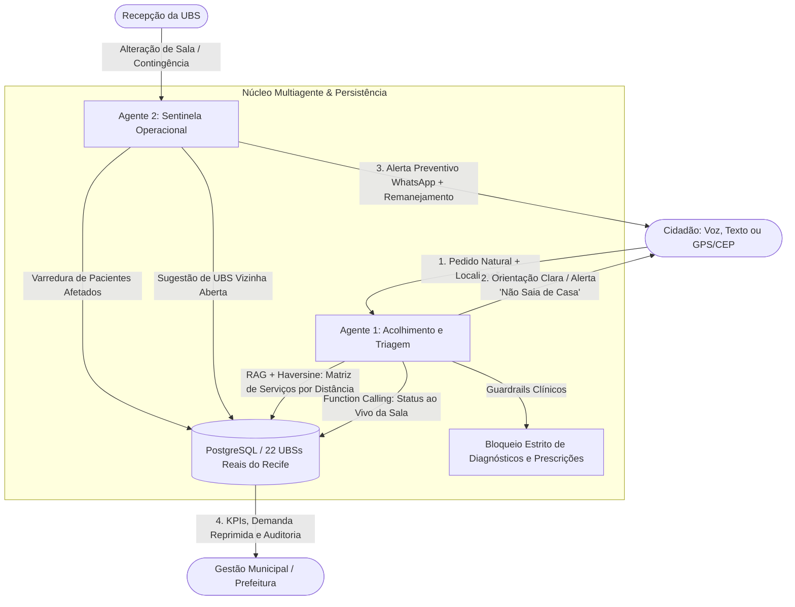

# 💙 Zelo — Ecossistema Multiagente de IA para a Atenção Básica do SUS
> **AKCIT Camp Multicêntrico 2026 — Etapa Regional Nordeste (Recife/PE)**  
> ** Joshua, Deyvson, Luiz e Cauã  
> **Tema:** B2G / GovTech / HealthTech — Eliminação de filas da madrugada e viagens perdidas nas Unidades Básicas de Saúde (UBS).

---

## 📌 Documentação e Artefatos do Pitch
- 📊 **Pitch Deck:** [`Pitch_Zelo_AKCIT.pdf`](./Pitch_Zelo_AKCIT.pdf)
- 📋 **Business Model Canvas:** [`BMC_Zelo.pdf`](./BMC_Zelo.pdf)
- 🗂️ **Base Oficial de Dados Abertos (Recife):** [`data/unidades-basicas-de-saude-ubs.csv`](./data/unidades-basicas-de-saude-ubs.csv) (22 UBSs reais com CNES, RPA, endereço, especialidades e coordenadas).

---

## 🎯 Visão Geral e Arquitetura

O **Zelo** é uma solução B2G baseada em **Agentes Autônomos de IA** que conecta em tempo real o cidadão, a recepção da UBS e a Secretaria Municipal de Saúde:



---

## 🌐 Os 4 Pontos de Acesso (Rotas da Aplicação)

Com o servidor rodando em `http://localhost:3000`, você tem acesso a interfaces dedicadas para cada perfil:

| Rota | Perfil / Público | O que faz |
| :--- | :--- | :--- |
| **`http://localhost:3000/cidadao`** | **👤 App do Cidadão** *(Mobile-First & Acessível)* | Chat com Agente 1 (voz e texto), localização por **GPS, CEP (ViaCEP) ou Bairro**, consulta de UBSs mais próximas em tempo real, agendamento validado na API e controles de acessibilidade (`A+` e alto contraste). |
| **`http://localhost:3000/ubs`** | **🏥 Portal da Recepção da UBS** *(Operação Local)* | Seletor com as **22 UBSs reais do Recife**, abertura/fechamento de salas em 1 clique, botão de disparo do **Agente 2 (Sentinela)**, fila de pacientes do dia, check-in de balcão e remanejamento ativo para unidades vizinhas abertas. |
| **`http://localhost:3000/gestao`** | **📊 Portal da Gestão Municipal** *(Prefeitura / B2G)* | KPIs em tempo real vindos do banco (viagens evitadas, horas poupadas, bloqueios de Guardrails), filtro por **RPA (1 a 6)**, tabela consolidada da rede, gráfico de demandas e log de auditoria. |
| **`http://localhost:3000/`** | **⚡ Hub / Painel do Pitch** *(Visão Integrada)* | Tela dividida com terminal de telemetria da IA (*Live Function Calling*, *RAG* e *Guardrails*) + atalhos no topo para abrir `/cidadao`, `/ubs` e `/gestao`. |

---

## 🛠️ Stack Tecnológica e Boas Práticas
- **Backend:** Node.js, Express, `@google/genai` (SDK oficial do Google Gemini com *Function Calling* multi-turno).
- **Banco de Dados:** **PostgreSQL 16** (`pg`) com schema relacional ([`db/schema.sql`](./db/schema.sql)) e *seed* automático das 22 UBSs reais do Recife ([`db/seedData.js`](./db/seedData.js)).
- **Modo Resiliente (Pitch-Safe):**
  - Se rodar **sem PostgreSQL**, o repositório ([`db/repository.js`](./db/repository.js)) faz *fallback* automático transparente para memória mantendo todas as 22 UBSs reais.
  - Se rodar **sem chave do Gemini** (ou se a internet oscilar), o orquestrador executa o motor determinístico autônomo com os mesmos dados reais e logs de ferramentas.
- **Geolocalização ([`geo/recife.js`](./geo/recife.js)):** Cálculo de distância via fórmula de Haversine + integração com ViaCEP + dicionário local de 42 bairros do Recife (sem gravar coordenadas exatas do cidadão, em conformidade com a LGPD).
- **Containerização:** `Dockerfile` (`node:22-alpine` enxuto com *healthcheck*) e `docker-compose.yml` orquestrando `app` + `db` (`postgres:16-alpine`).

---

## 🚀 Como Instalar e Rodar na Sua Máquina

Você pode rodar o projeto de **duas formas**: via **Docker Compose** (com PostgreSQL incluso) ou diretamente com **Node.js** (sem precisar instalar banco).

### Pré-requisitos
- **Git** instalado.
- **Opção A:** [Docker Desktop](https://www.docker.com/products/docker-desktop/) instalado e aberto.
- **Opção B:** [Node.js](https://nodejs.org/) (v18 ou superior) e NPM instalados.

---

### Passo 1: Clonar o Repositório e Configurar o `.env`

No terminal (PowerShell, CMD, Git Bash ou Linux/macOS):

```bash
# 1. Clone o repositório
git clone https://github.com/Joshua-Brito/ZELO-AKCIT-CAMP.git
cd ZELO-AKCIT-CAMP

# 2. Crie o arquivo .env a partir do exemplo
cp .env.example .env
```

*(No Windows PowerShell/CMD você também pode usar `copy .env.example .env`).*

Abra o arquivo `.env` em qualquer editor de texto e insira sua chave gratuita do [Google AI Studio](https://aistudio.google.com/app/apikey):

```env
PORT=3000
GEMINI_API_KEY=AIzaSy_SUA_CHAVE_AQUI
GEMINI_MODEL=gemini-3.1-flash-lite
```
> 💡 **Nota:** Mesmo que você deixe `GEMINI_API_KEY` sem preencher, o sistema funciona normalmente utilizando o Motor Autônomo Determinístico (*Pitch-Safe*).

---

### Passo 2 (Opção A — Recomendada): Rodar com Docker + PostgreSQL

Com o **Docker Desktop** aberto, execute na raiz do projeto:

```bash
docker compose up --build
```
*(Para rodar em segundo plano, use `docker compose up -d --build`).*

O Docker irá:
1. Subir o container `zelo-postgres` (`postgres:16-alpine`) na porta `5432`.
2. Criar automaticamente as tabelas (`ubss`, `salas`, `pacientes`, `metricas_gestao`, `logs_auditoria`) e popular as **22 UBSs reais do Recife**.
3. Subir o container `zelo-app` na porta `3000`.

Para parar os containers:
```bash
docker compose down
```

---

### Passo 2 (Opção B): Rodar Direto com Node.js (Sem Docker)

Se não quiser usar Docker no momento, basta instalar os pacotes e iniciar:

```bash
# 1. Instala as dependências
npm install

# 2. Inicia o servidor
npm start
```
*(Em modo de desenvolvimento com reload automático, use `npm run dev`).*

---

## 🎤 Roteiro Rápido de Teste / Demonstração

1. **Abra o App do Cidadão (`http://localhost:3000/cidadao`):**
   - Teste o botão **Usar GPS** ou clique em **CEP / Bairro** (ex: escolha *Torrões* ou digite o CEP `50630-000`).
   - Vá na aba **Unidades** e veja as 22 UBSs reais do Recife ordenadas pela distância até você.
   - Na aba **Zelo (Chat)**, envie: *"Preciso tomar vacina admissional hoje às 14h perto de mim"*. Veja o Agente 1 descartar a unidade sem vacina, detectar que a sala de vacina de Torrões (`US 106`) está em reunião e recomendar a unidade aberta mais próxima (`US 112 - Iputinga`).
   - Teste o **Guardrail Clínico**: *"Estou com dor de cabeça e febre, qual remédio eu tomo?"*.
2. **Abra o Portal da UBS (`http://localhost:3000/ubs`):**
   - Com a *US 106 CS Prof Joaquim Cavalcante (Torrões)* selecionada, clique em **🚨 Sinalizar Interrupção & Notificar Fila (Agente 2)** ou feche/reabra salas em tempo real.
   - Clique em **Remanejar p/ vizinha aberta** na linha da Dona Maria José e veja o status atualizar instantaneamente no App do Cidadão (`/cidadao`).
3. **Abra o Portal da Gestão (`http://localhost:3000/gestao`):**
   - Filtre as unidades por **RPA (1 a 6)** e acompanhe os KPIs de viagens evitadas, alertas enviados e o **Log de Auditoria** atualizado em tempo real.


Visão Geral da Arquitetura Multiagente
O sistema opera com uma divisão de responsabilidades entre dois agentes autônomos integrados a uma camada de ferramentas (Tools):

Snippet de código
graph TD
    A[Cidadão / Usuário] -->|Input em Linguagem Natural| B[Agente 1: Triagem & Acolhimento]
    C[Recepção / Gestão UBS] -->|Alerta Operacional| D[Agente 2: Sentinela Operacional]
    
    subgraph Orquestração de IA & Ferramentas
        B -->|RAG + Function Calling| E[(Catálogo Oficial SUS & Status ao Vivo)]
        D -->|Busca Preditiva & Alerta| F[(Base de Agendados & Vizinhança)]
    end
    
    E -->|Output: Janela e Ficha Segura| A
    F -->|Output: Alerta Preventivo WhatsApp| A
Detalhamento do Fluxo (Inputs, Lógica e Outputs)
1. Agente 1: Triagem, Descoberta e Acolhimento (Foco no Cidadão)
Inputs:

Mensagem de texto ou áudio informal enviada pelo cidadão (ex.: "Preciso tomar vacina admissional hoje às 14h perto de casa").

Contexto de localização do usuário (geolocalização ou bairro).

Lógica de Raciocínio (Orquestração e Ferramentas):

RAG (Retrieval-Augmented Generation): O agente consulta a base de dados oficial e vetorizada do município para cruzar o serviço desejado (vacinação) com a matriz real de competências de cada UBS, descartando unidades que não ofertam o procedimento.

Function Calling (consultar_status_ao_vivo): Executa chamadas dinâmicas ao banco de dados operacional para verificar o status em tempo real da unidade (ex.: se a sala está aberta, se há vagas remanescentes ou se ocorreu interrupção temporária).

Outputs:

Resposta preditiva e orientativa ao usuário ("A UBS mais próxima não vacina e a segunda está em reunião interna; reservei sua senha prioritária para amanhã às 08h00 ou você pode ir à UBS San Martin que está vacinando agora").

Emissão de protocolo digital / ficha de atendimento com janela horária garantida.

2. Agente 2: Sentinela Operacional Autônomo (Foco na Gestão e Prevenção)
Inputs:

Evento operacional lançado pela recepcionista da UBS no painel administrativo (ex.: "Sala de vacina fechada para reunião de equipe" ou "Médico ausente por motivo de saúde").

Lógica de Raciocínio (Orquestração e Ferramentas):

Autonomia Baseada em Eventos (listar_afetados e realocar_vizinha): Ao receber o gatilho de imprevisto, o agente aciona a ferramenta de varredura para identificar instantaneamente todos os cidadãos que possuem fichas ou agendamentos confirmados para aquele turno na respectiva sala.

Outputs:

Disparo automático de alertas preventivos via WhatsApp para os cidadãos afetados antes que eles saiam de casa (barrando a viagem perdida).

Sugestão automática de remanejamento para a UBS vizinha operante e atualização em tempo real do dashboard gerencial da Secretaria de Saúde.

🛡️ Engenharia de Confiabilidade & Guardrails
Bloqueio Clínico Estrito: O escopo do agente é 100% administrativo, logístico e de navegação. Guardrails rígidos no prompt de sistema impedem qualquer tentativa de diagnóstico médico ou prescrição de medicamentos.

Prevenção de Alucinação: O RAG é restrito estritamente aos catálogos e regulamentos oficiais do município, impedindo invenção de horários ou serviços.

Privacidade e LGPD: Dados de identificação (como CPF ou Cartão do SUS) são tokenizados e processados em ambiente seguro na nuvem, respeitando a conformidade com a legislação de proteção de dados.
