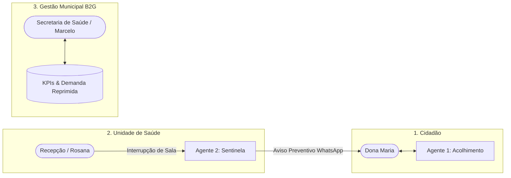

# 💙 Zelo — Ecossistema Multiagente de IA para a Atenção Básica do SUS
> **AKCIT Camp Multicêntrico 2026 — Etapa Regional Nordeste (Recife/PE)**  
> **Squad 13:** Joshua, Deyvson, Luiz e Cauã  
> **Tema:** B2G / GovTech / HealthTech — Eliminação de filas da madrugada e viagens perdidas na Atenção Básica do SUS.

---

## 📌 Documentação e Artefatos do Pitch
- 📊 **Pitch Deck:** [`Pitch_Zelo_AKCIT.pdf`](./Pitch_Zelo_AKCIT.pdf)
- 📋 **Business Model Canvas:** [`BMC_Zelo.pdf`](./BMC_Zelo.pdf)

---

## 🎯 A Solução: Os 3 Portais Navegáveis Integrados

O Zelo evoluiu de um protótipo isolado para um **ecossistema multi-portal navegável em tempo real**, conectando as 3 pontas da atenção básica do SUS:



### 👤 1. Portal do Cidadão (Acolhimento & Triagem)
- **Foco:** Idosos, famílias e trabalhadores.
- **Chat com Agente 1 (Google Gemini):** RAG na matriz oficial de serviços + Function Calling de status em tempo real.
- **Ficha Digital Zelo:** Cartão de agendamento que monitora se a sala da UBS está aberta ou em reunião técnica.
- **Alerta Preventivo WhatsApp:** Visualização das mensagens ativas recebidas pelo cidadão para evitar viagens perdidas.

### 🏥 2. Portal da Recepção da UBS (Operação Local)
- **Foco:** Recepcionistas e enfermeiros-chefes (Persona "Rosana").
- **Controle de Salas em Tempo Real:** Toggles com 1 clique para alterar o status das salas (Sala de Vacinas, Consultório Clínico, Odonto).
- **Gatilho de Contingência do Sentinela:** Acionamento do Agente 2 para varrer e alertar preventivamente os pacientes agendados.
- **Fila de Pacientes e Remanejamento:** Opção de remanejar a fila diretamente para unidades vizinhas abertas (ex: UBS San Martin).

### 📊 3. Portal da Gestão Municipal (Secretaria de Saúde / B2G)
- **Foco:** Secretário de Saúde e Diretores da Atenção Básica (Persona "Marcelo").
- **Big Numbers de Impacto:**
  - 🚫 **1.482 Viagens Perdidas Evitadas** no município.
  - ⏱️ **4.890 Horas de Fila da Madrugada Poupadas**.
  - 📉 **Redução de No-Show/Absenteísmo de 38% para 8.2%**.
  - 💰 **R$ 194.200,00 Economizados** em custos operacionais e transporte sanitário.
- **Mapeamento da Demanda Real:** Gráfico de distribuição de pedidos identificados via IA em linguagem natural.
- **Auditoria de IA & Guardrails:** 100% de conformidade com as diretrizes do SUS (bloqueio estrito de diagnósticos).
- **Recomendação Autônoma:** Sugestões ativas de remanejamento de profissionais entre UBSs conforme a sobrecarga.

---

## 🛠️ Tecnologias
- **Backend:** Node.js, Express, `@google/genai` (SDK oficial do Google Gemini).
- **Modelo de IA:** Google Gemini (`gemini-3.1-flash-lite` com Function Calling multi-turno).
- **Frontend:** SPA responsiva moderna com navegação fluida entre os 3 portais sem recarregar a página.

---

## 🚀 Como Executar o Projeto

```bash
# 1. Instale as dependências
npm install

# 2. Configure sua chave no .env
# GEMINI_API_KEY=AIzaSy...

# 3. Inicie a aplicação
npm start
```
Acesse no navegador: **`http://localhost:3000`**

Alterne entre os 3 portais na barra superior:
- `[👤 1. Portal do Cidadão]`
- `[🏥 2. Recepção da UBS]`
- `[📊 3. Gestão Municipal]`
